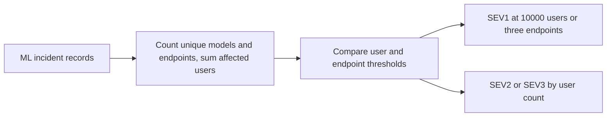

# ML Incident Impact Summarizer

Summarizes ML incident blast radius from model, endpoint, feature, and customer segment data.

Focus: AI/ML platform incident response.

Built as a small, runnable Python project with clear input, output, sample data, and tests.

## Run

```bash
python3 ml_impact.py sample_ml_incidents.csv
```

## Verify

```bash
python3 -m unittest discover . -v
```

## Local verification

Run `make verify` with Make and Python 3 installed. The target runs the documented sample through the project CLI. It also runs the existing Python unit tests.

## Business problem

When several models are affected, responders need to estimate endpoint coverage and customer impact from the incident records they have.

## Project walkthrough



[Architecture and data flow](docs/ARCHITECTURE.md) · [Business problem, demo, and verification](docs/CASE_STUDY.md)
